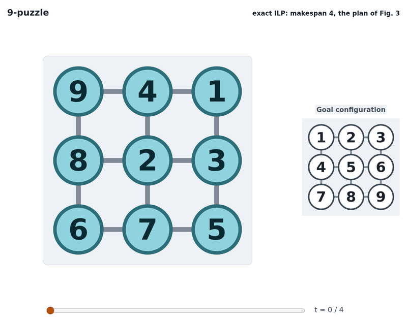
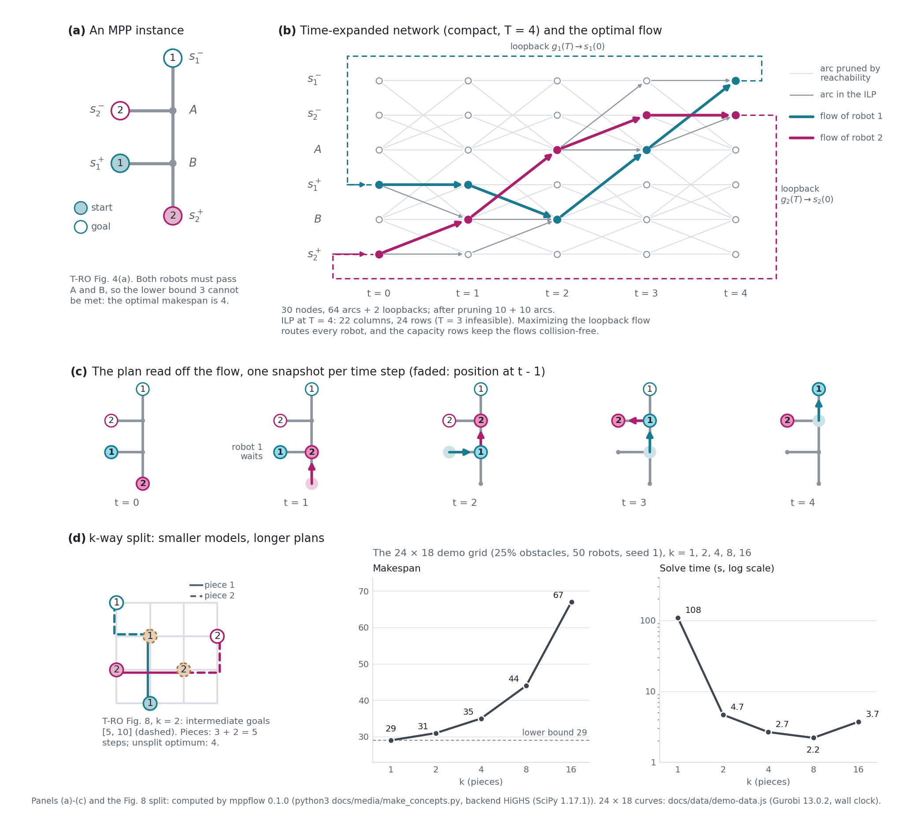

# multiagent-network-flow

Optimal multi-robot path planning (multi-agent path finding, MAPF) on graphs with integer linear
programming: a Python package (`mppflow`) and a browser demo of our
[T-RO 2016](https://doi.org/10.1109/TRO.2016.2593448) and
[ICRA 2013](https://doi.org/10.1109/ICRA.2013.6631084) algorithms, which build on the
network-flow reduction of our [WAFR 2012](https://doi.org/10.1007/978-3-642-36279-8_10) paper.

[](https://ru-arcl.github.io/multiagent-network-flow/)

Try it in your browser: **<https://ru-arcl.github.io/multiagent-network-flow/>**

## The idea

Labeled robots move synchronously on a graph, each waiting or moving to a neighbour in every
time step; no two robots may meet at a vertex or swap head-on along an edge, but they may follow
each other and rotate along a fully occupied cycle. Our ILP uses a time-expanded network with
one copy of each vertex per time step 0, ..., T, wait arcs from v(t) to v(t+1), and per edge
and step two crossing move arcs, one per direction. Each vertex copy carries at most one unit of
flow, which forbids meetings (T-RO eq. 18), and the two move arcs of an edge carry at most one
unit together, which forbids head-on swaps (eq. 17). With a loopback arc from each robot's goal
at time T to its start at time 0, every collision-free plan of horizon T is an integer
multiflow of value n (the number of robots, one commodity each), and every such flow is a
plan. This is the compact form of T-RO's network, which has 2T + 1 vertex copies and a
merge-split gadget per edge ([both gadgets](docs/media/gadget.png)); panel (b) below draws it.
Solving it as an ILP gives complete and exact algorithms for four objectives: makespan, maximum
distance, total arrival time and total distance.

The ILP grows with the number of robots, vertices and time steps. Our k-way split heuristic
picks intermediate goals along each robot's shortest path, cutting the instance into k
sub-instances with short horizons, and solves them exactly one after the other. On our 50-robot
demo grid, 4 pieces give makespan 35 instead of the optimal 29, in 2.7 s instead of 108 s
(Gurobi). The split handles hundreds of robots on densely occupied graphs, often in seconds.



*(a) The two-robot tree of T-RO Fig. 4(a); (b) its compact time-expanded network at T = 4 and
the optimal flow found by the ILP; (c) the plan read off the flow; (d) the k-way split: the
Fig. 8 instance with k = 2, and the makespan and the solve time against k on the 24x18 demo grid.*

## What's here

| path | contents |
|---|---|
| [`mppflow/`](mppflow) | Python package: graphs and instance generators, the time-expanded networks, ILP models for the four objectives, the k-way split and the other planners of the original code, the local-repair heuristics of ICRA 2013 Sec. VI-C (collisions between shortest paths are resolved by solving small sub-problems exactly), the experiment drivers, a CLI and a matplotlib viewer ([API](docs/API.md), [design](docs/DESIGN.md)) |
| [`docs/`](docs) | the static browser demo (`index.html`, `js/`, `data/`), served by GitHub Pages; the planner runs in the page ([engine](docs/js/README.md), [maps](docs/data/README.md)) |
| [`tests/`](tests) | pytest suite: golden fixtures recorded from the original Java code (`tests/golden/`), every worked example of the papers (`tests/data/paper/`), independent oracles, and parity fixtures that tie the JavaScript engine to the Python package |
| [`tools/golden/`](tools/golden) | the Java harness that records the golden fixtures from the original code |
| [`docs/notes/`](docs/notes) | [paper errata](docs/notes/paper-errata.md), [bugs in the original code](docs/notes/original-bugs.md), [papers vs. code](docs/notes/paper-vs-code.md), [solver notes](docs/notes/solver-notes.md), each with reproduction scripts |

## Quick start

```sh
git clone https://github.com/ru-arcl/multiagent-network-flow
cd multiagent-network-flow
pip install .              # Python >= 3.10; numpy and scipy >= 1.15.3 (HiGHS) are the only dependencies
```

The 9-puzzle of T-RO Fig. 1, solved for minimum makespan:

```python
import mppflow

# Robot labels on the 3x3 grid of T-RO Fig. 1, row by row; vertex id = 3 * row + col.
start = [9, 4, 1,
         8, 2, 3,
         6, 7, 5]
starts = [start.index(i) for i in range(1, 10)]   # robot label i has index i - 1
problem = mppflow.Problem(mppflow.create_2d_grid_graph(3, 3), starts, list(range(9)))
result = mppflow.plan(problem, "makespan")        # exact ILP, HiGHS by default
print(result.status, result.makespan, mppflow.validate(problem, result.paths))
```

prints `optimal 4 None` (`None`: the plan is valid). Robots are indexed from 0:
`result.paths[i][t]` is the vertex of robot label `i + 1` at time `t`. The command line does the same for files and generated instances:

```console
$ python -m mppflow solve --grid 8x8 --obstacles 0.2 --robots 20 --seed 1 --no-paths
instance: 52 vertices, 20 robots
status: optimal  objective: makespan = 10
makespan 10 (lb 9), total time 196 (lb 88), total distance 162 (lb 88), max distance 10
time 0.809 s, 3 models solved
```

This is the output with scipy 1.17.1 (scipy bundles HiGHS), and the times in this paragraph
are scipy 1.17.1's too; scipy 1.18.1, the newest release, prints the same plan. (Both have
HiGHS presolve defects on some general-integer models, which our models avoid as far as we
have seen; see the [solver notes](docs/notes/solver-notes.md).) The time line varies by machine and HiGHS version (8-20 s on our machine
with scipy 1.15.3, the newest scipy for Python 3.10), and so can the statistics that the
objective does not fix: with scipy 1.15.3, HiGHS returns another plan of makespan 10, with total
time 195. `tests/test_api.py` runs both examples (the time line and these statistics are only
checked for plausibility). Add `--split 2` (or 4, 8, ...) for the k-way split and `--json` for
machine-readable output (with `--no-paths`, the JSON leaves out the paths).
`--objective max_distance` takes 2-4 s here (15-30 s with scipy 1.15.3). On large grids with
few robots, HiGHS presolve can make the makespan ILP 15-100x slower than with presolve off
(`params={"presolve": False}` in the Python API) or with Gurobi (`--backend gurobi`); see
section 1 of the [solver notes](docs/notes/solver-notes.md).
`total_time` and `total_distance` are harder: on this instance HiGHS needs about a minute
(total time) or many minutes (total distance) for the ILP at the optimal makespan alone, before
the search over longer horizons T even starts, so a short `--time-limit` alone ends with no plan.
Split it instead: `--objective total_distance --split 2 --time-limit 20` returns a plan of total
distance 138 (status `feasible`) in 5-6 s (5-12 s with scipy 1.15.3). `python -m mppflow view ...`
animates a plan (needs `pip install ".[viewer]"`).

**Demo.** Open `docs/index.html` in a browser. It works from `file://`, with no server and no
network access.

**Tests.**

```sh
pip install ".[test]"
python -m pytest -m "not slow"     # a few minutes; drop -m "not slow" for everything
npm test                           # Node >= 18: JavaScript engine vs. Python package, exactly
```

The tests run from a clone of the repository (they read `tests/`, `docs/` and `tools/`; the
sdist holds the library only). The Gurobi tests (marker `gurobi`; `-m "not gurobi"` leaves them
out) run only when gurobipy has a full license (pip's bundled license, limited to
2000 variables and constraints, makes them skip; `MPPFLOW_TEST_GUROBI=0` skips them without
probing the license). Without it the suite still checks objective
values and plan validity on HiGHS and the builtin solver, and the original-mode records whose
outcome no solver decides (hangs, Java exceptions, rejected path sets). What needs the license
is the exact comparison of plans, logs and random draws with the golden records, which holds
only under the Gurobi version and settings they were recorded with. Inside pytest, the `npm test`
script runs with `node` itself (npm is not needed) and skips without Node >= 18.

**Gurobi (optional).** `pip install ".[gurobi]"`, then `backend="gurobi"` or `--backend gurobi`.
The license bundled with pip's gurobipy covers small models only (2000 variables and
constraints; the 8x8 example above is already too large), so most models need a full Gurobi
license (free for academic use); without one, the command line prints
`error: GurobiError: Model too large for size-limited license ...`. The models are built
column for column as in the original, so with the Gurobi version our golden fixtures were
recorded with (13.0.2) and `Threads=1` (`params={"Threads": 1}` / `--threads 1`), the plans
equal the original's.

## Differences from the original

`mppflow` ports every non-GUI function of the original Java code
(<https://github.com/arc-l/optimal-mrppg-journal>), with two modes:

* `compat="fixed"` (default) corrects the bugs we found and equals the original everywhere else
  (same instances from the same seed, same models in the same order).
* `compat="original"` reproduces the original, bugs included: a Java crash raises the matching
  `mppflow.errors.Java*` exception, and an endless loop raises `OriginalWouldHang` instead of
  hanging.

The most important of the 27 corrected bugs ([all of them](docs/notes/original-bugs.md)):

* [B1](docs/notes/original-bugs.md#b-infeasible): on an infeasible instance the makespan
  search loops forever (we raise `Infeasible` when a joint-state search or a polynomial
  certificate proves it; a large instance that neither settles still needs `t_max` or a time
  limit).
* [B2](docs/notes/original-bugs.md#b-timelimit): the elapsed time is subtracted from the time
  limit again at every horizon, and a spent limit means "no limit" (we time out instead, and
  `plan` rejects a limit <= 0 with `ValueError`: pass `None` for no limit).
* [B6](docs/notes/original-bugs.md#b-timer): an int overflow drops constraints of the
  one-move-per-step model.
* [B10](docs/notes/original-bugs.md#b-splitloop), [B11](docs/notes/original-bugs.md#b-endpoints):
  the split's intermediate-goal search can loop forever, and it never lets a robot keep its own
  start or goal, which lengthens split plans.
* [B14](docs/notes/original-bugs.md#b-mt): the threaded split planner can hang, reuse stale
  pieces or lose a piece to a race.

Also new or changed:

* **MinMaxDist** (T-RO eqs. 12-13) is implemented; the original code has no such model.
* **Horizon search.** Total time and total distance search the horizon T as in Algorithm 1, so
  they are optimal over all T. The original solves at one T, the makespan of a 4-way split
  (`compat="original"`); `horizon="single"` also solves at one T, the optimal makespan,
  and is then optimal at that T only (in both cases the status is `"feasible"` unless the
  plan meets the lower bound).
* **Regenerated benchmarks.** The original benchmark files are lost. `python -m mppflow generate`
  regenerates the same families and file formats from a seed (the same distribution, not the
  same instances; the families share one stream, so a subset gives other instances); see [papers vs. code](docs/notes/paper-vs-code.md#reproducibility).

We also found errors in our papers ([all 16](docs/notes/paper-errata.md)). None affects
`mppflow`, which implements the corrected forms; only E11 (MinMakespan has no bound on T) also
affects the original code, as bug B1. Examples:

* T-RO eq. (15) for the total arrival time is off by one; minimizing it literally can return a
  non-optimal plan ([E1](docs/notes/paper-errata.md#e1)).
* With the stated arc costs, the distance objectives (T-RO eqs. 12, 13, 16; ICRA eq. 7) are
  constant; waits must be free ([E2](docs/notes/paper-errata.md#e2)).
* The flow-to-plan map of Theorem 1 is onto but not one-to-one; the reduction and all optimal
  values are unaffected ([E4](docs/notes/paper-errata.md#e4)).
* The split example of T-RO Fig. 8 needs 3 + 2 steps, not 2 + 2 ([E6](docs/notes/paper-errata.md#e6)).
* The diagonal gadget of ICRA Fig. 6 admits head-on swaps ([E12](docs/notes/paper-errata.md#e12)).

## Citing

```bibtex
@article{YuLav16TOR,
  author = {Jingjin Yu and Steven M. LaValle},
  title = {Optimal Multirobot Path Planning on Graphs: Complete Algorithms and Effective Heuristics},
  journal = {IEEE Transactions on Robotics}, volume = {32}, number = {5}, pages = {1163--1177},
  year = {2016}, doi = {10.1109/TRO.2016.2593448}
}
@inproceedings{YuLav13ICRA,
  author = {Jingjin Yu and Steven M. LaValle},
  title = {Planning Optimal Paths for Multiple Robots on Graphs},
  booktitle = {2013 IEEE International Conference on Robotics and Automation (ICRA)},
  address = {Karlsruhe, Germany}, pages = {3612--3617}, year = {2013},
  doi = {10.1109/ICRA.2013.6631084}
}
@incollection{YuLav13STAR,
  author = {Jingjin Yu and Steven M. LaValle},
  title = {Multi-agent Path Planning and Network Flow},
  booktitle = {Algorithmic Foundations of Robotics X (WAFR 2012)}, editor = {E. Frazzoli and others},
  series = {Springer Tracts in Advanced Robotics}, volume = {86}, pages = {157--173},
  publisher = {Springer}, address = {Berlin, Heidelberg}, year = {2013},
  doi = {10.1007/978-3-642-36279-8_10}
}
```

## License

BSD 3-Clause; see [LICENSE](LICENSE). Algorithmic Robotics and Control (ARC) Lab, Rutgers University.
